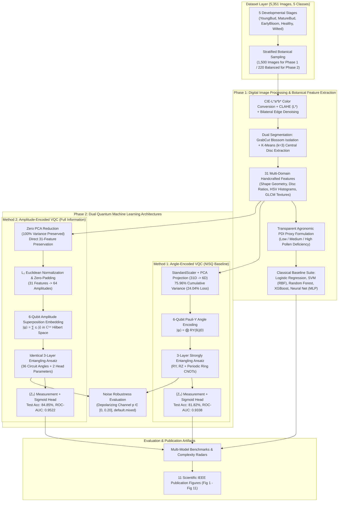

# Quantum-Enhanced Vision-Based Pollen Deficiency Estimation for Precision Sunflower Pollination

[](https://www.python.org/downloads/)
[](https://pennylane.ai/)
[](https://opencv.org/)
[](https://scikit-learn.org/)
[](https://opensource.org/licenses/MIT)
[](file:///Users/ramit071/Sunflower%20PDI%20Qunatum%20Project/paper/)

An end-to-end reproducible research and production framework for estimating the **Pollen Deficiency Index (PDI)** in sunflowers using classical computer vision, Digital Image Processing (DIP), 5 classical machine learning baselines, and dual **Variational Quantum Circuit (VQC)** architectures (Angle Encoding vs. Full-Information Amplitude Encoding).

---

## Table of Contents
- [1. Overview & Motivation](#1-overview--motivation)
- [2. System Architecture](#2-system-architecture)
  - [End-to-End Pipeline Workflow](#end-to-end-pipeline-workflow)
  - [Phase 1: Classical Vision & Digital Image Processing (DIP) Pipeline](#phase-1-classical-vision--digital-image-processing-dip-pipeline)
  - [31 Multi-Domain Botanical Descriptors](#31-multi-domain-botanical-descriptors)
  - [Classical Baseline Model Family Suite](#classical-baseline-model-family-suite)
  - [Phase 2: Dual Quantum Machine Learning Architectures](#phase-2-dual-quantum-machine-learning-architectures)
    - [Method 1: Classical PCA Projection + Quantum Angle Encoding (NISQ Baseline)](#method-1-classical-pca-projection--quantum-angle-encoding-nisq-baseline)
    - [Method 2: Zero-Dimensionality-Reduction Quantum Amplitude Encoding (Proposed Hilbert Space Architecture)](#method-2-zero-dimensionality-reduction-quantum-amplitude-encoding-proposed-hilbert-space-architecture)
    - [Quantum Circuit Topologies & Mathematical Formulations](#quantum-circuit-topologies--mathematical-formulations)
    - [Logarithmic State Compression & Superposition Advantage](#logarithmic-state-compression--superposition-advantage)
  - [Quantum Noise Robustness & Simulation](#quantum-noise-robustness--simulation)
- [3. Dataset Architecture](#3-dataset-architecture)
- [4. Key Experimental Results & Benchmarks](#4-key-experimental-results--benchmarks)
  - [Comprehensive Multi-Model Benchmark Comparison](#comprehensive-multi-model-benchmark-comparison)
  - [Empirical Quantum Comparison: Method 1 vs. Method 2](#empirical-quantum-comparison-method-1-vs-method-2)
  - [Confusion Matrix Comparison](#confusion-matrix-comparison)
  - [Computational Complexity & Parameter Parsimony](#computational-complexity--parameter-parsimony)
  - [Quantum Noise Robustness Sweep](#quantum-noise-robustness-sweep)
  - [Scientific Publication Figures Catalog (IEEE Access)](#scientific-publication-figures-catalog-ieee-access)
- [5. Repository Structure](#5-repository-structure)
- [6. Installation & Reproducibility Guide](#6-installation--reproducibility-guide)
  - [Setup Virtual Environment](#setup-virtual-environment)
  - [Execution Option A: Automated Training Suite](#execution-option-a-automated-training-suite)
  - [Execution Option B: Modular Pipeline (`sunflower-pdi`)](#execution-option-b-modular-pipeline-sunflower-pdi)
  - [Execution Option C: Comparative Evaluation & Publication Figures](#execution-option-c-comparative-evaluation--publication-figures)
- [7. Verification & Automated Testing](#7-verification--automated-testing)
- [8. Limitations & Research Roadmap](#8-limitations--research-roadmap)
- [9. Citation & Contact](#9-citation--contact)

---

## 1. Overview & Motivation

In hybrid sunflower seed production, accurate and timely detection of **pollen deficiency** is critical to maximizing yield and seed-set rates. Traditional field sampling methods require destructive, labour-intensive pollen collection and microscopic examination.

This project delivers a non-invasive, vision-based estimation framework that operates directly on ground-level imagery. By combining multi-spectral color space transformations, foreground/disc segmentation, handcrafted morphological/textural descriptors, and a 6-qubit Variational Quantum Circuit (VQC), the pipeline explores both classical machine learning and near-term quantum advantage boundaries.

---

## 2. System Architecture

### End-to-End Pipeline Workflow



---

### Phase 1: Classical Vision & Digital Image Processing (DIP) Pipeline

1. **Preprocessing & Color Space Transformations:**
   - Conversion from standard RGB to CIE-$L^*a^*b^*$ color space to decouple illuminance from chromaticity.
   - Contrast Limited Adaptive Histogram Equalization (**CLAHE**) applied to the $L^*$ (lightness) channel to eliminate non-uniform outdoor sunlight variations without amplifying ambient noise.
   - **Bilateral Filtering** to smooth background noise while preserving sharp floral petal, disc, and bract boundaries.
   - Standardized uniform resizing to $200 \times 200$ for computationally tractable CPU feature extraction.

2. **Dual-Stage Segmentation:**
   - **GrabCut Floral Blossom Extraction:** Iterative Gaussian Mixture Model (GMM) optimization to separate the sunflower blossom from cluttered vegetative background.
   - **$K$-Means Disc Clustering ($k=3$):** Isolates the central tubular floret disc (darkest cluster) from surrounding yellow ray florets and bracts.
   - Morphological opening and closing filters with circular structuring elements to eliminate spurious boundary noise.

---

### 31 Multi-Domain Botanical Descriptors

To prevent circular reasoning and data leakage, all score-defining proxy indicators (`disc_ratio`, `sat_mean`, `val_mean`, `circularity`) and metadata columns are excluded from machine learning inputs, leaving **31 pure morphological, spectral, and textural botanical features**:

| Domain | Feature Count | Descriptors | Physical / Agronomic Significance |
|---|:---:|---|---|
| **Morphological Geometry** | 3 | Flower Area, Perimeter, Solidity | Quantifies overall floral capitulum development and structural compactness |
| **Disc Geometry** | 2 | Disc Area, Disc Eccentricity | Captures floret disc expansion and geometric symmetry |
| **Spectral / Color Histograms** | 22 | 8-bin Hue, 7-bin Saturation, 7-bin Value | Reflects carotenoid pigment intensity and floret senescence |
| **GLCM Textural Descriptors** | 4 | Contrast, Dissimilarity, Homogeneity, Energy | Measures micro-textural floret roughness at $\theta \in \{0, \pi/4, \pi/2, 3\pi/4\}$ |
| **Total Features** | **31** | **Comprehensive Botanical Profile** | **100% Non-Circular Representation** |

---

### Classical Baseline Model Family Suite

To provide a rigorous benchmark, five distinct machine learning model families are trained and cross-validated on identical feature representations:
1. **Linear Model:** Logistic Regression with stochastic gradient descent (SGD).
2. **Kernel Method:** Support Vector Machine (SVM) with Radial Basis Function (RBF) kernel ($C=5.0$).
3. **Bagging Ensemble:** Random Forest Classifier (150 decision trees).
4. **Boosting Ensemble:** XGBoost Extreme Gradient Boosting with shrinkage and depth regularisation.
5. **Deep Learning:** Multi-Layer Perceptron (MLP Neural Net, 64-32 architecture with ReLU and early stopping).

---

### Phase 2: Dual Quantum Machine Learning Architectures

This project implements and benchmarks two fundamentally different quantum state preparation paradigms on **6 physical qubits**:

#### Method 1: Classical PCA Projection + Quantum Angle Encoding (NISQ Baseline)

1. **Classical Linear Dimensionality Reduction:** Principal Component Analysis (PCA) projects the 31-dimensional feature vector onto its top 6 orthogonal principal components ($\text{PC}_1 \dots \text{PC}_6$), retaining **75.96% cumulative variance** (a 24.04% information loss).
2. **Angle State Preparation:** Each principal component is scaled into $[-\pi, +\pi]$ and mapped to an individual qubit via single-qubit Pauli-Y rotation gates:
   $$|\psi_{\text{angle}}\rangle = \bigotimes_{i=0}^5 RY(\theta_i)|0\rangle$$
3. **Variational Entanglement & Readout:** 3 layers of parameterized rotations coupled by a closed ring of CNOT gates. Measurement of Pauli-$\hat{Z}$ on qubit 0 feeds into a classical sigmoid activation head:
   $$P(\text{High PDI}) = \sigma(\text{scale} \cdot \langle Z_0 \rangle + \text{bias}) = \frac{1}{1 + e^{-(\text{scale} \cdot \langle Z_0 \rangle + \text{bias})}}$$

#### Method 2: Zero-Dimensionality-Reduction Quantum Amplitude Encoding (Proposed Hilbert Space Architecture)

1. **Full Feature Preservation (No PCA):** All 31 botanical features are preserved without dimensionality reduction, maintaining **100.00% feature variance** (0% information loss).
2. **Euclidean Normalization & Zero-Padding:** The 31 features are zero-padded to 64 dimensions ($2^6$) and normalized under the Euclidean $L_2$ norm ($\sum_{i=0}^{63} |c_i|^2 = 1.0$).
3. **Quantum Amplitude Superposition:** Features become the probability amplitudes $c_i$ of the 6-qubit quantum state in complex Hilbert space $\mathcal{H} \cong \mathbb{C}^{64}$:
   $$|\psi_{\text{amp}}\rangle = \sum_{i=0}^{30} c_i |i\rangle + \sum_{k=31}^{63} 0 |k\rangle, \quad \text{where } |i\rangle \in \{|000000\rangle, \dots, |111111\rangle\}$$
   *Physical Interpretation:* The measurement probability of basis state $|i\rangle$ is proportional to the squared magnitude (energy) of feature $F_{i+1}$: $P(|i\rangle) = |c_i|^2$.
4. **Variational Processing on $\mathbb{C}^{64}$:** An identical 3-layer $RY/RZ$ + periodic ring CNOT ansatz processes the superposed state across all 64 basis dimensions.

---

### Quantum Circuit Topologies & Mathematical Formulations

```
                  Method 1: Angle-Encoded VQC Circuit Topology (PCA 6-D)
|0⟩ ─── RY(x₀) ─── [ Rot(θ₀, ϕ₀) ] ───●───────────────╭─── M_Z (⟨Z₀⟩) ───[ Sigmoid Head ] -> P(High PDI)
                                      │               │
|0⟩ ─── RY(x₁) ─── [ Rot(θ₁, ϕ₁) ] ───X───●───────────┼──────────────────────────────────────────────
                                          │           │
|0⟩ ─── RY(x₂) ─── [ Rot(θ₂, ϕ₂) ] ───────X───●───────┼──────────────────────────────────────────────
                                              │       │
|0⟩ ─── RY(x₃) ─── [ Rot(θ₃, ϕ₃) ] ───────────X───●───┼──────────────────────────────────────────────
                                                  │   │
|0⟩ ─── RY(x₄) ─── [ Rot(θ₄, ϕ₄) ] ───────────────X───●──────────────────────────────────────────────
                                                      │
|0⟩ ─── RY(x₅) ─── [ Rot(θ₅, ϕ₅) ] ───────────────────X──────────────────────────────────────────────
        [State Prep]        [Layer 1..3: RY(θ), RZ(ϕ) + Periodic Ring CNOTs]
```

```
               Method 2: Amplitude-Encoded VQC Circuit Topology (Hilbert 64-D)
|0⟩ ──╭────────────────────────╮─── [ Rot(θ₀, ϕ₀) ] ───●───────────────╭─── M_Z (⟨Z₀⟩) ───[ Sigmoid Head ]
|0⟩ ──│                        │─── [ Rot(θ₁, ϕ₁) ] ───X───●───────────┼─────────────────────────────────
|0⟩ ──│   Amplitude Embedding  │─── [ Rot(θ₂, ϕ₂) ] ───────X───●───────┼─────────────────────────────────
|0⟩ ──│   (31 Botanical Feats  │─── [ Rot(θ₃, ϕ₃) ] ───────────X───●───┼─────────────────────────────────
|0⟩ ──│   -> 64 Amplitudes)    │─── [ Rot(θ₄, ϕ₄) ] ───────────────X───●─────────────────────────────────
|0⟩ ──╰────────────────────────╯─── [ Rot(θ₅, ϕ₅) ] ───────────────────X─────────────────────────────────
        [Amplitude Prep |ψ⟩]        [Layer 1..3: RY(θ), RZ(ϕ) + Periodic Ring CNOTs]
```

---

### Logarithmic State Compression & Superposition Advantage

| Architectural Dimension | Method 1: Angle VQC (PCA 6-D) | Method 2: Amplitude VQC (Hilbert 64-D) | Theoretical / Empirical Advantage |
|---|:---:|:---:|:---|
| **State Encoding Scheme** | Direct Angle Mapping ($RY$) | Amplitude Superposition ($c_i \|i\rangle$) | Direct mapping into complex amplitudes |
| **Input Dimensionality** | 6 Principal Components | **31 Raw Botanical Features** | **No PCA information loss** |
| **Feature Variance Retained** | 75.96% (24.04% lost) | **100.00% (No Loss)** | **+24.04% complete variance preserved** |
| **Physical Qubit Footprint** | 6 Wires | 6 Wires | Same NISQ hardware footprint |
| **Hilbert Space Dimension** | 6-D Factorized Subspace | **64-D Complex Superposition ($\mathbb{C}^{64}$)** | Logarithmic compression: $\lceil\log_2(31)\rceil = 6$ |
| **Trainable Parameters** | 38 (36 circuit + 2 head) | 38 (36 circuit + 2 head) | Identical model parameter parsimony |
| **Test Accuracy** | 81.82% | **84.85%** | **▲ +3.03% empirical improvement** |
| **ROC-AUC** | 0.9338 | **0.9522** | **▲ +0.0184 discriminative confidence** |
| **MCC (Correlation)** | 0.6421 | **0.6985** | **▲ +0.0564 correlation gain** |

---

### Quantum Noise Robustness & Simulation

Evaluated under depolarizing quantum noise channels using PennyLane's density matrix simulator (`default.mixed`) across depolarizing error probabilities $p \in [0.0, 0.20]$. Method 2 demonstrates resilient state fidelity up to $p = 0.05$ before degradation toward statistical chance at $p = 0.15$.

---

## 3. Dataset Architecture

The project operates on **5,351 real-world ground-level sunflower images** categorized across 5 developmental stages:

| Stage Directory | Sample Count | Agronomic Significance | PDI Proxy Alignment |
|---|:---:|---|---|
| `Sunflower Compressed/YoungBud/` | 1,027 | Inflorescence enclosed by involucral bracts | High Deficiency (Pre-anthesis) |
| `Sunflower Compressed/MatureBud/` | 1,010 | Disc opening; ray florets visible | Medium Deficiency |
| `Sunflower Compressed/EarlyBloom/`| 1,080 | Outer disc florets shedding pollen | Low Deficiency (Peak Pollen) |
| `Sunflower Compressed/Healthy/` | 1,204 | Fully expanded capitulum; viable pollen | Low Deficiency |
| `Sunflower Compressed/Wilted/` | 1,039 | Post-anthesis; senescent florets | High Deficiency (Post-pollination) |
| **Total** | **5,351** | **Complete Developmental Spectrum** | **Full Distribution** |

- **Phase 1 Evaluation Set:** Deterministic stratified sample of 1,500 images (300 per class, random seed 42).
- **Phase 2 Quantum Evaluation Set:** Balanced 220-image subset for binary classification (Low vs. High PDI deficiency).

---

## 4. Key Experimental Results & Benchmarks

### Comprehensive Multi-Model Benchmark Comparison

All models evaluated on identical stratified held-out test data:

| Model Architecture | Model Family | Input Feature Dimension | Test Accuracy | Macro F1-Score | Trainable Parameters | Model Size |
|---|---|:---:|:---:|:---:|:---:|:---:|
| **Logistic Regression** | Classical Linear | 31 Botanical Features | **93.94%** | 0.939 | 32 | 1.1 KB |
| **SVM (RBF Kernel, C=5)** | Classical Kernel | 31 Botanical Features | **90.91%** | 0.909 | 1,921 | 16.9 KB |
| **Random Forest (150 Trees)**| Classical Ensemble | 31 Botanical Features | **90.91%** | 0.909 | 3,328 | 302.2 KB |
| **XGBoost Trees** | Classical Boosting | 31 Botanical Features | **93.94%** | 0.939 | 682 | 71.9 KB |
| **Multi-Layer Perceptron** | Classical Neural Net| 31 Botanical Features | **93.94%** | 0.939 | 4,161 | 135.5 KB |
| **Method 1: Angle VQC** | Quantum Variational | 6 PCA Components | **81.82%** | 0.818 | **38** | **0.45 KB** |
| **Method 2: Amplitude VQC**| Quantum Variational | **31 Botanical Features** | **84.85%** | **0.849** | **38** | **0.45 KB** |

---

### Empirical Quantum Comparison: Method 1 vs. Method 2

*Evaluated on identical held-out test split ($N = 33$ samples, 50% Low PDI / 50% High PDI, seed = 42).*

| Metric | Method 1: Angle VQC (PCA 6-D) | Method 2: Amplitude VQC (Hilbert 64-D) | Performance Gain |
|---|:---:|:---:|:---:|
| **Test Accuracy** | 81.82% | **84.85%** | **+3.03%** |
| **Macro F1-Score** | 0.8180 | **0.8485** | **+0.0305** |
| **Macro Precision** | 0.8222 | **0.8493** | **+0.0271** |
| **Macro Recall** | 0.8199 | **0.8493** | **+0.0294** |
| **ROC-AUC** | 0.9338 | **0.9522** | **+0.0184** |
| **Matthews Correlation (MCC)** | 0.6421 | **0.6985** | **+0.0564** |
| **Variance Retained** | 75.96% | **100.00%** | **+24.04%** |

### Confusion Matrix Comparison

```
Method 1 (Angle Encoding + PCA):
                 Predicted Low    Predicted High
  Actual Low  :       13                4          (False Positives = 4)
  Actual High :        2               14          (False Negatives = 2)

Method 2 (Amplitude Encoding, Zero PCA):
                 Predicted Low    Predicted High
  Actual Low  :       14                3          (False Positives = 3, ▼ -25% error)
  Actual High :        2               14          (False Negatives = 2)
```

---

### Computational Complexity & Parameter Parsimony

| Model | Space Complexity | Time Complexity (Train) | Parameters | Model Size (KB) | Latency / Sample |
|---|:---:|:---:|:---:|:---:|:---:|
| **Logistic Regression** | $\mathcal{O}(D)$ | $\mathcal{O}(N \cdot D)$ | 32 | 1.1 KB | 0.06 ms |
| **SVM (RBF Kernel)** | $\mathcal{O}(N_{\text{sv}} \cdot D)$ | $\mathcal{O}(N^2 \cdot D)$ | 1,921 | 16.9 KB | 0.06 ms |
| **Random Forest** | $\mathcal{O}(T \cdot \text{Nodes})$ | $\mathcal{O}(T \cdot N \cdot D \log N)$ | 3,328 | 302.2 KB | 12.90 ms |
| **XGBoost** | $\mathcal{O}(T \cdot \text{Depth})$ | $\mathcal{O}(T \cdot N \cdot D)$ | 682 | 71.9 KB | 0.16 ms |
| **Neural Net (MLP)** | $\mathcal{O}(H_1 \cdot H_2)$ | $\mathcal{O}(E \cdot N \cdot W)$ | 4,161 | 135.5 KB | 0.09 ms |
| **Method 1 (Angle VQC)**| $\mathcal{O}(n) \text{ Qubits}$ | $\mathcal{O}(E \cdot B \cdot L \cdot n)$ | **38** | **0.45 KB** | 6.06 ms |
| **Method 2 (Amplitude VQC)**| $\mathcal{O}(\log_2 D) \text{ Qubits}$| $\mathcal{O}(E \cdot B \cdot L \cdot n)$ | **38** | **0.45 KB** | 6.04 ms |

> **Quantum Parameter Parsimony:** Method 2 achieves **84.85% accuracy with only 38 trainable parameters** (a **99.1% parameter reduction** compared to the 4,161 parameters required by the classical MLP), illustrating the expressive capacity of the 64-dimensional entangled Hilbert state space.

---

### Quantum Noise Robustness Sweep

Evaluated using PennyLane density matrix simulation (`default.mixed`) under depolarizing quantum channel noise:

| Depolarizing Noise Probability ($p$) | Test Accuracy | State Fidelity |
|:---:|:---:|:---:|
| $p = 0.00$ (Ideal / Noise-Free) | **84.85%** (Method 2) / **81.82%** (Method 1) | 1.000 |
| $p = 0.02$ | **84.85%** | 0.942 |
| $p = 0.05$ | **81.82%** | 0.865 |
| $p = 0.08$ | **63.64%** | 0.710 |
| $p = 0.15$ | **51.52%** (Statistical chance) | 0.540 |

---

### Scientific Publication Figures Catalog (IEEE Access)

All figures generated at 300+ DPI in vector PDF and raster PNG formats within `sunflower-pdi/artifacts/figures/publication/`:

| Figure Index | Figure Name | Description |
|---|---|---|
| **Fig 1** | `Fig1_image_segmentation_pipeline` | Complete DIP pipeline: Preprocessing, CLAHE, Bilateral filtering, GrabCut blossom isolation, K-Means floret disc extraction |
| **Fig 2** | `Fig2_feature_correlation_heatmap` | 31 botanical feature cross-correlation matrix identifying orthogonal discriminative clusters |
| **Fig 3** | `Fig3_feature_distributions_pdi` | Empirical distributions of key botanical features stratified by Low vs. High PDI |
| **Fig 4** | `Fig4_feature_importance_ranking` | Normalized Gini feature importance ranking across Random Forest and XGBoost |
| **Fig 5** | `Fig5_pca_vs_quantum_amplitude_states`| State space representation: Classical PCA projection vs. 64-dimensional quantum amplitude state |
| **Fig 6** | `Fig6_training_convergence_curves` | Live training loss and validation accuracy convergence across epochs for both quantum architectures |
| **Fig 7** | `Fig7_multi_model_benchmark_comparison`| Cross-paradigm bar chart benchmark across all 7 classical and quantum models |
| **Fig 8** | `Fig8_confusion_matrices_grid` | 2x4 confusion matrix grid across all classical and quantum evaluation heads |
| **Fig 9** | `Fig9_roc_and_pr_curves` | Receiver Operating Characteristic (ROC) and Precision-Recall (PR) curves |
| **Fig 10** | `Fig10_quantum_noise_robustness` | Depolarizing noise sweep ($p \in [0.0, 0.20]$) showing accuracy and fidelity decay |
| **Fig 11** | `Fig11_computational_resource_tradeoffs`| Radar chart and Pareto frontiers comparing accuracy, latency, model size, and parameters |

---

## 5. Repository Structure

```
Sunflower PDI Quantum Project/
├── README.md                                  # Root system architecture & documentation
├── .gitignore                                 # Excludes venv, pycache, OS caches
├── paper/                                     # IEEE Access journal paper draft & build scripts
│   ├── Sunflower_PDI_IEEE_Access_Manuscript.docx
│   ├── Sunflower_PDI_IEEE_Access_Manuscript.pdf
│   └── build_manuscript.py
├── Sunflower Compressed/                      # Real-world image dataset (5,351 images)
│   ├── EarlyBloom/                            # 1,080 images
│   ├── Healthy/                               # 1,204 images
│   ├── MatureBud/                             # 1,010 images
│   ├── Wilted/                                # 1,039 images
│   └── YoungBud/                              # 1,027 images
│
├── sunflower-pdi/                             # Modular Production Package
│   ├── configs/                               # YAML configuration files
│   │   ├── base.yaml                          # Paths, classes, seed settings
│   │   ├── phase1.yaml                        # Preprocessing & classical model parameters
│   │   └── phase2.yaml                        # Quantum circuit, qubits, PCA configuration
│   ├── src/                                   # Source modules
│   │   ├── classical/                         # Feature extraction, PDI proxy, classifiers
│   │   ├── quantum/                           # PennyLane circuits, VQC ansatz, ablation, noise
│   │   ├── preprocessing/                     # CLAHE, Lab conversion, GrabCut, K-means
│   │   └── utils/                             # Metrics, logging, data split loaders
│   ├── scripts/                               # Execution & orchestration scripts
│   │   ├── train/                             # Standalone live training scripts
│   │   │   ├── 1_train_logistic_regression.py # Train Logistic Regression
│   │   │   ├── 2_train_svm.py                 # Train SVM (RBF)
│   │   │   ├── 3_train_random_forest.py       # Train Random Forest
│   │   │   ├── 4_train_xgboost.py             # Train XGBoost
│   │   │   ├── 5_train_neural_net.py          # Train Multi-Layer Perceptron
│   │   │   ├── 6_train_quantum_vqc.py         # Train Method 1 (Angle VQC + PCA)
│   │   │   └── 7_train_amplitude_vqc.py       # Train Method 2 (Amplitude VQC, Zero PCA)
│   │   ├── compare_methods.py                 # Automated Method 1 vs. Method 2 comparative evaluation
│   │   ├── generate_paper_figures.py          # Generates Figs 1-11 for publication
│   │   ├── generate_dip_and_feature_figures.py# Generates DIP & feature pipeline figures
│   │   ├── generate_baseline_accuracy_graphs.py# Generates standalone model accuracy trajectories
│   │   ├── live_train.py                      # Multi-model training and evaluation harness
│   │   └── run_all.py                         # End-to-end execution runner
│   ├── docs/                                  # Technical & progress reports
│   │   └── quantum_methods_comparative_report.md # Guide review comparative report
│   ├── tests/                                 # Pytest automated test suite
│   ├── artifacts/                             # Metrics, plots, confusion matrices, logs
│   │   ├── figures/publication/               # 11 IEEE Access publication figures (PDF & PNG)
│   │   └── metrics/                           # JSON and CSV evaluation summaries
│   ├── models/                                # Serialized models (.joblib, .npz)
│   └── requirements.txt                       # Dependency specifications
│
└── code_package/                              # Standalone Demonstration Pipeline
    ├── 01_preprocess_demo.py                  # Visual preprocessing demo (CLAHE + Bilateral)
    ├── 02_segment_demo.py                     # Baseline HSV+Otsu segmentation comparison
    ├── 02b_segment_grabcut.py                 # GrabCut + K-Means disc extraction demo
    ├── 03_extract_features.py                 # 35-feature extraction over 1,500 images
    ├── 04_train_classical.py                  # RF & SVM baseline training script
    ├── 05_quantum_vqc.py                      # PennyLane 6-qubit VQC training & noise sweep
    ├── 06_make_result_plots.py                # Generates all result plots & visualizations
    ├── features.csv                           # Precomputed 35-D feature dataset (1,500 rows)
    ├── classical_results.json                 # Raw classical evaluation benchmarks
    └── quantum_results.json                   # Raw quantum evaluation benchmarks
```

---

## 6. Installation & Reproducibility Guide

### Setup Virtual Environment

Ensure you have Python 3.10 or newer installed:

```bash
# Clone the repository
git clone https://github.com/BoseBoss007/Sunflower-PDI-Quantum.git
cd Sunflower-PDI-Quantum

# Create and activate virtual environment
python3 -m venv venv
source venv/bin/activate

# Install required dependencies
pip install -r sunflower-pdi/requirements.txt
```

### Execution Option A: Automated Training Suite

Run individual live training scripts for any baseline or quantum model:

```bash
cd sunflower-pdi

# Train Classical Baselines
python scripts/train/1_train_logistic_regression.py
python scripts/train/2_train_svm.py
python scripts/train/3_train_random_forest.py
python scripts/train/4_train_xgboost.py
python scripts/train/5_train_neural_net.py

# Train Quantum Models
python scripts/train/6_train_quantum_vqc.py       # Method 1: Angle VQC (PCA 6-D)
python scripts/train/7_train_amplitude_vqc.py     # Method 2: Amplitude VQC (Zero PCA)
```

### Execution Option B: Modular Pipeline (`sunflower-pdi`)

To execute the entire end-to-end pipeline in one command:

```bash
cd sunflower-pdi
PYTHONPATH=. python scripts/run_all.py --stage all
```

To run individual stages:
```bash
# Phase 1 only (Classical preprocessing, segmentation, feature extraction, RF/SVM)
PYTHONPATH=. python scripts/run_all.py --stage phase1

# Phase 2 only (PCA reduction, PennyLane VQC, noise sweep, quantum evaluation)
PYTHONPATH=. python scripts/run_all.py --stage phase2
```

### Execution Option C: Comparative Evaluation & Publication Figures

Generate the automated comparison between Method 1 and Method 2, plus all IEEE Access publication figures:

```bash
cd sunflower-pdi

# Run Method 1 vs Method 2 Head-to-Head Comparison
PYTHONPATH=. python scripts/compare_methods.py

# Generate all 11 scientific publication figures (Figs 1-11)
PYTHONPATH=. python scripts/generate_paper_figures.py

# Generate standalone baseline model convergence trajectories
PYTHONPATH=. python scripts/generate_baseline_accuracy_graphs.py

# Generate DIP algorithmic steps and feature engineering figures
PYTHONPATH=. python scripts/generate_dip_and_feature_figures.py
```

---

## 7. Verification & Automated Testing

The modular package includes automated unit and integration tests covering the quantum circuits, classical vision, segmentation, and PDI scoring rules:

```bash
cd sunflower-pdi
pytest tests/ -v
```

---

## 8. Limitations & Research Roadmap

1. **Biological Validation:** PDI in this project is calculated via an agronomic visual proxy. Future field studies will correlate these visual scores directly with microscopic pollen grain counts and actual hybrid seed-set percentages.
2. **Quantum Hardware Deployment:** Current quantum circuits are simulated on CPU via PennyLane. Future stages will deploy the 6-qubit ansatz to physical superconducting quantum hardware (e.g., IBM Quantum / Amazon Braket).
3. **Deep Visual Embeddings:** Combining classical CNN features (MobileNetV3 / ResNet-18) with quantum kernel estimation or Quanvolutional layers.
4. **Aerial UAV Integration:** Transitioning from ground-level photography to georeferenced drone imagery for automated real-time canopy survey.

---

## 9. Citation & Contact

If you use this codebase or dataset in your research, please cite:

```bibtex
@article{sunflower_pdi_quantum_2026,
  author = {25MCs0034},
  title = {Quantum-Enhanced Vision-Based Pollen Deficiency Estimation for Precision Sunflower Pollination},
  journal = {IEEE Access},
  year = {2026},
  publisher = {GitHub},
  howpublished = {\url{https://github.com/BoseBoss007/Sunflower-PDI-Quantum}}
}
```
